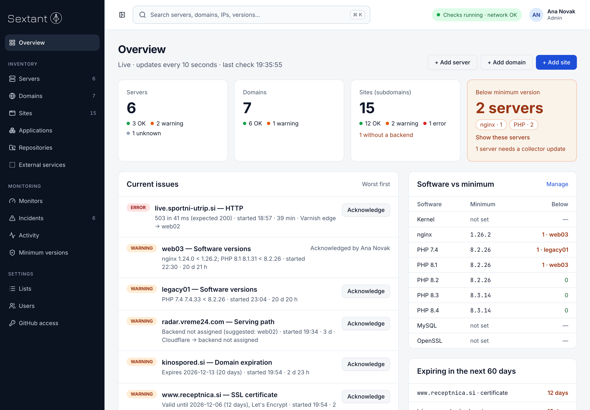
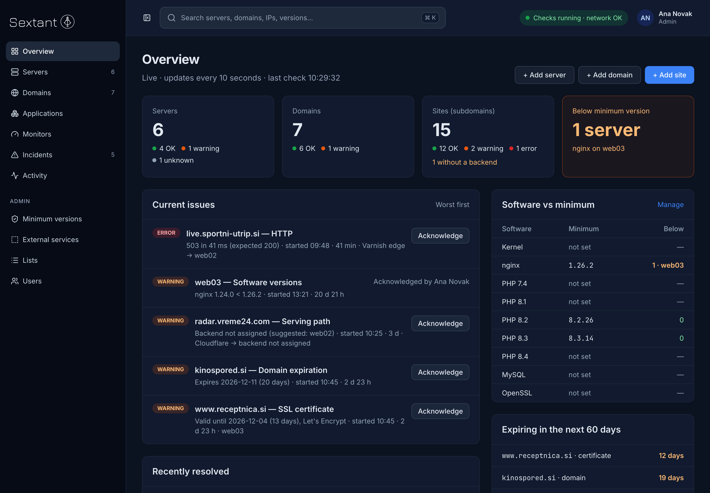
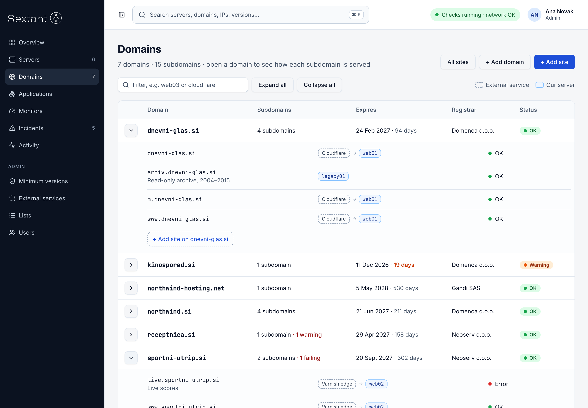
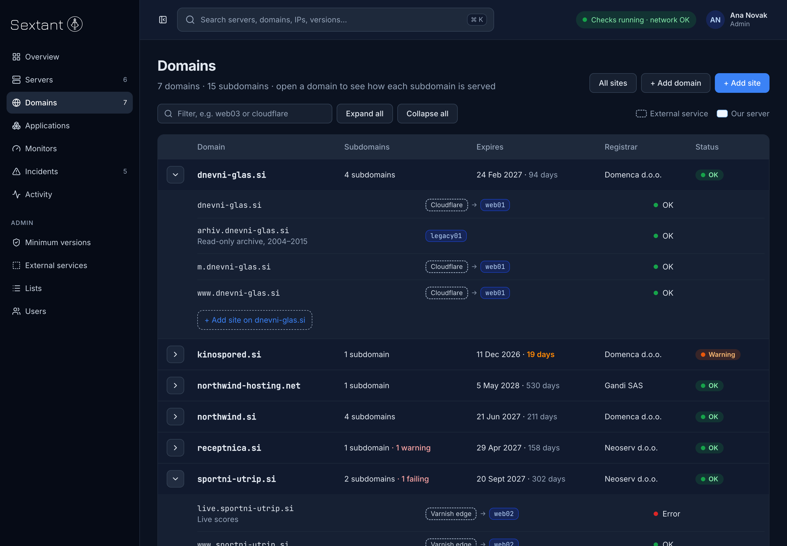
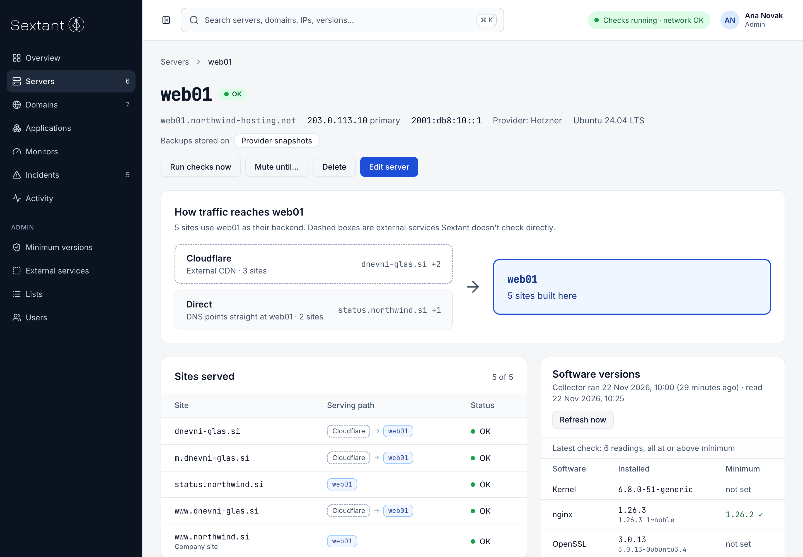
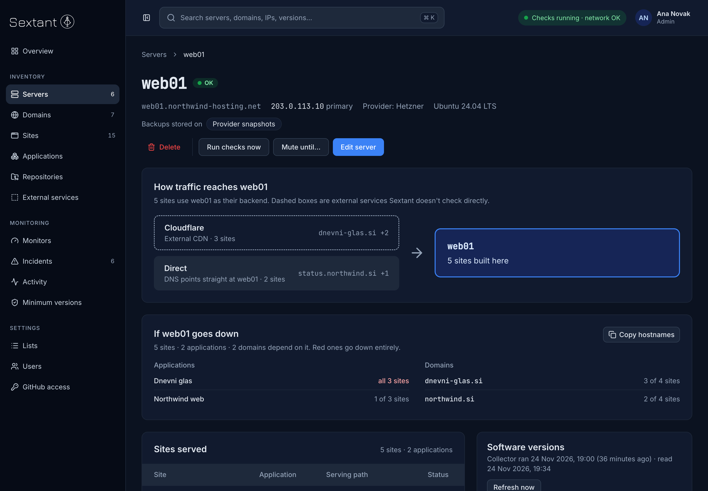
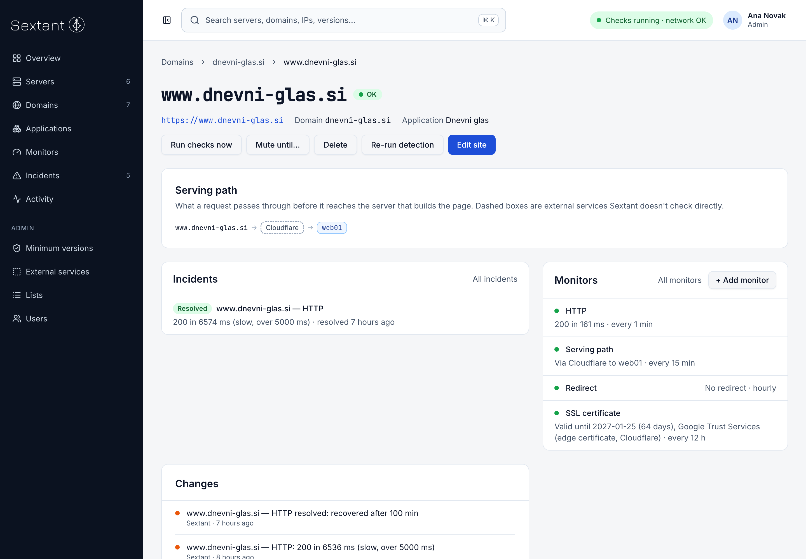
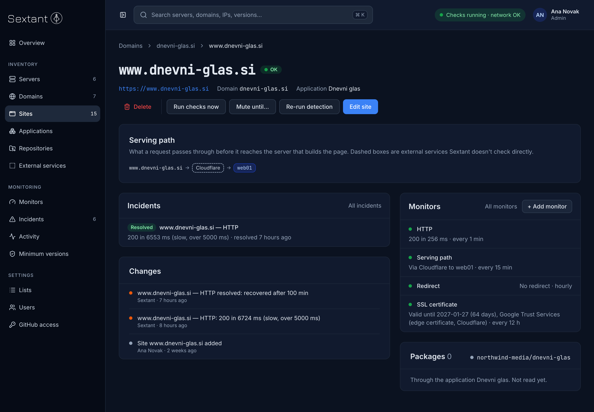
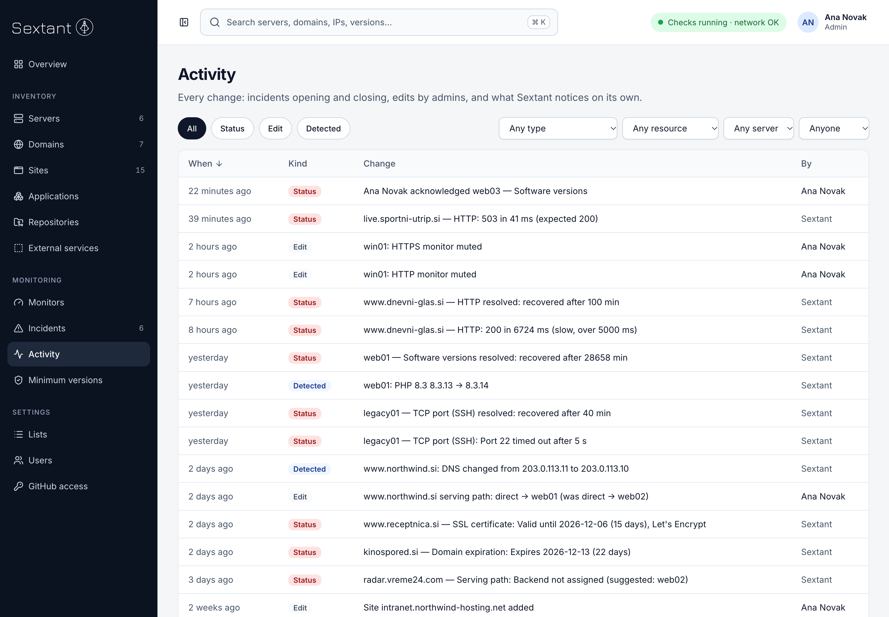
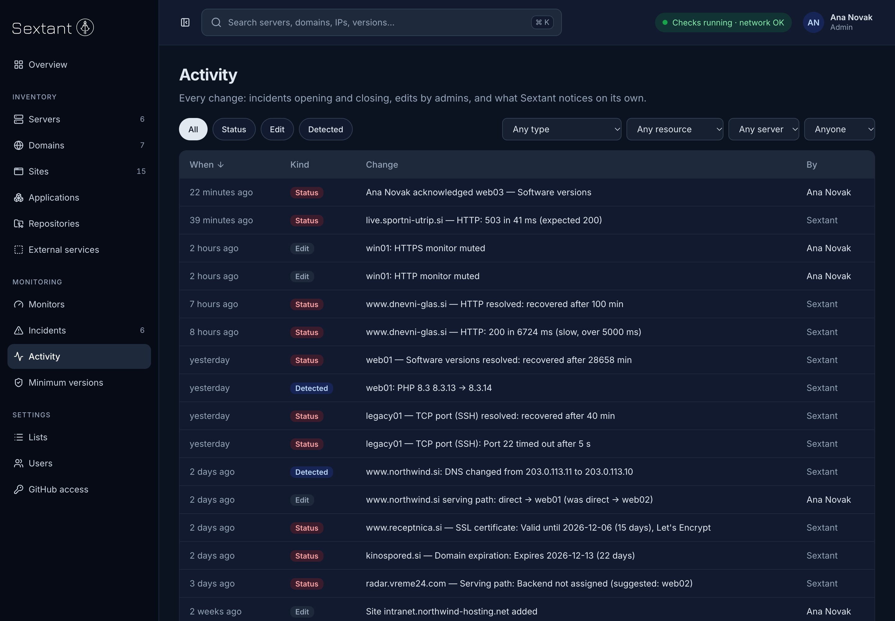

# Sextant

In-house overview and monitoring for Media24: domains, sites, servers, how each site is served, server software versions, and health checks with Discord alerts.

- What and why: [`docs/GOAL.md`](docs/GOAL.md). How: [`docs/SPEC.md`](docs/SPEC.md). Build plan: [`docs/TODO.md`](docs/TODO.md).
- Working on the code: [`docs/CLAUDE.md`](docs/CLAUDE.md) has the commands and rules.

This README is the runbook: deploying, adding a checker, installing the collector, rotating a token, handling a false positive, and backups.

## Screenshots

Fictional demo data (`database/seeders/DemoSeeder.php`), light and dark.

| Light                                                                   | Dark                                                  |
| ----------------------------------------------------------------------- | ----------------------------------------------------- |
| **Overview**: current issues, software below minimum, what expires soon |                                                       |
|                  |  |
| **Domains**: every subdomain and how it's served                        |                                                       |
|                    |    |
| **Server**: traffic into it, sites it serves, software versions         |                                                       |
|                      |      |
| **Site**: serving path, monitors, incidents                             |                                                       |
|                          |          |
| **Activity**: status changes, admin edits, what Sextant detects         |                                                       |
|                  |  |

To recreate the data, seed an empty database (no network access; it runs three days of checks against fakes and takes about two minutes). Sign in as `admin@example.com` / `password`.

```bash
DB_DATABASE=sextant_demo php artisan migrate:fresh --seed --seeder=DemoSeeder
```

---

## Deploying

Sextant runs on its own server, outside the infrastructure it monitors (SPEC §16).

### Requirements

- PHP 8.4 with `intl`, `openssl`, `curl`, `redis`, `pdo_mysql`; Composer; Node 22.
- MySQL 9.7, Redis, nginx + php-fpm.
- `iputils-ping` with `cap_net_raw` (`getcap /usr/bin/ping` → `cap_net_raw=ep`), so `server.ping` works as the web and worker users. Sextant pings over IPv4 only (`docs/spikes/icmp.md`).
- Outbound firewall: 53/udp and 53/tcp, 80, 443, 43 (WHOIS), and every TCP port you check (22 for SSH monitors).

### MySQL user

MySQL 9.7 has no `mysql_native_password`. Connect over the Unix socket (`DB_SOCKET`) or TLS (`MYSQL_ATTR_SSL_CA`):

```sql
CREATE DATABASE sextant CHARACTER SET utf8mb4 COLLATE utf8mb4_0900_ai_ci;
CREATE USER 'sextant'@'localhost' IDENTIFIED WITH caching_sha2_password BY '…';
GRANT ALL ON sextant.* TO 'sextant'@'localhost';
```

### Environment

Copy `.env.example` to `.env` and set at least:

| Variable                                      | Notes                                                                               |
| --------------------------------------------- | ----------------------------------------------------------------------------------- |
| `APP_URL`, `APP_KEY`                          | `php artisan key:generate` once                                                     |
| `DB_*`                                        | as above                                                                            |
| `QUEUE_CONNECTION=redis`, `CACHE_STORE=redis` | Horizon needs Redis                                                                 |
| `DISCORD_WEBHOOK_URL`                         | Incident messages. A secret: never log or share it; rotate it in Discord if exposed |
| `SENTRY_LARAVEL_DSN`                          | Sextant's own errors and cron check-ins; `SENTRY_TRACES_SAMPLE_RATE=0`              |
| `SEXTANT_BACKEND_HEADER`                      | Optional, e.g. `X-Backend`; off by default (SPEC §10.3)                             |

### Build and release

Run `./deploy.sh` on the server as the app user. It pulls `main` (fast-forward only, refuses local changes), runs `composer install --no-dev`, `npm ci && npm run build` (also generates the TypeScript types), `migrate --force` and `optimize`, validates the checker registry, then restarts Horizon and the scheduler with the new code. Set `PHP_FPM_SERVICE=php8.4-fpm` to also reload php-fpm (needs sudo), e.g. when OPcache doesn't revalidate timestamps.

The first time, also:

```bash
php artisan sextant:create-admin
php artisan proxies:refresh          # CDN IP ranges (then daily)
php artisan rdap:refresh-bootstrap   # RDAP servers and the Public Suffix List (then weekly)
php artisan sextant:checkers         # the registry must say "valid"
```

### Processes

Run Horizon and the scheduler under systemd (or supervisor). `schedule:work`, not a cron-invoked `schedule:run`: `notifications:flush` runs every 30 seconds.

```ini
# /etc/systemd/system/sextant-horizon.service
[Unit]
Description=Sextant Horizon
After=network.target redis.service mysql.service

[Service]
User=sites
WorkingDirectory=/var/www/sextant
ExecStart=/usr/bin/php artisan horizon
Restart=always
RestartSec=5

[Install]
WantedBy=multi-user.target
```

```ini
# /etc/systemd/system/sextant-scheduler.service
[Unit]
Description=Sextant scheduler
After=network.target redis.service mysql.service

[Service]
User=sites
WorkingDirectory=/var/www/sextant
ExecStart=/usr/bin/php artisan schedule:work
Restart=always
RestartSec=5

[Install]
WantedBy=multi-user.target
```

Horizon's supervisors (`config/horizon.php`): `checks` autoscales 5–20 processes, `checks-slow` 2, `notifications` 1 (keeps Discord messages in order), `default` 2.

### Sentry Crons

Sentry gets Sextant's own health only (GOAL decision 2). Check-ins:

- the `monitors:dispatch` monitor (every minute, from the scheduler);
- `sextant-queue-checks`, `sextant-queue-checks-slow`, `sextant-queue-notifications` (every 5 minutes, 2-minute margin, from `sextant:heartbeat`).

Create a Sentry alert for missed or failed check-ins that posts to the incidents Discord channel. A stopped scheduler or worker is then reported within 10 minutes.

### On every monitored server

- Add Sextant's IP to fail2ban's `ignoreip` (SSH is checked every minute).
- Allowlist Sextant's IP in Cloudflare/WAF rules, so HTTP checks aren't challenged.
- Install the versions collector and endpoint (below).

### After adding a checker or changing defaults

Existing resources don't get new default monitors automatically. Attach them per checker, dry run first:

```bash
php artisan monitors:sync-defaults --checker=site.redirect --dry-run
php artisan monitors:sync-defaults --checker=site.redirect
```

`--checker` is required, so monitors someone deleted on purpose never come back by accident.

---

## Adding a checker

A checker is a class, a registry entry and tests (SPEC §4).

1. **Class** in `app/Checks/{Server,Domain,Site}/`, extending `ServerChecker`, `DomainChecker` or `SiteChecker`:

    ```php
    class PortChecker extends ServerChecker
    {
        public function __construct(private TcpProbe $tcp) {}   // network only through app/Net

        public static function name(): string { return 'Port'; }

        public static function arguments(): array
        {
            return [Argument::int('port', 'Port')->rules(['between:1,65535'])];
        }

        protected function check(Server $server, Arguments $arguments): CheckResult
        {
            // Return ok/warning/error about the server. If the check can't run for
            // reasons on Sextant's side (resolver timeout, rate limit), throw
            // CheckCouldNotRun: it becomes Unknown and never opens an incident.
        }
    }
    ```

    Optional: `trackedFields()` (data keys whose changes go to the change feed, with an activity type) and `describeChange()`.

2. **Registry entry** in `config/checkers.php` under a key whose prefix matches the base class (`server.port`): `class`, `queue` (`checks` or `checks-slow`), `interval` (minutes), `failures_before_incident`, `successes_before_resolve`, optional `max_severity`, and a default for every argument. Add it to `defaults` (with an `only_if` condition if it doesn't fit every resource) if new resources should get it.
3. **Validate**: `php artisan sextant:checkers` must say "valid".
4. **Tests** with the fakes in `app/Net/Fake` (see `tests/Feature/Checkers/`): every result it can give, and the cases that must be Unknown. No live network in the default suite; real-network tests use `->group('live')`.
5. **Try it**: `php artisan monitors:run {id} --no-save -v` prints the result without storing it.
6. **Existing resources**: `monitors:sync-defaults --checker=…` (above).

---

## Installing the versions collector on a server

Sextant never logs in to servers. An hourly root cron writes `/var/lib/sextant/versions.json` (readable by every user, so any PHP-FPM pool can serve it); a small `versions.php` hands it to Sextant with a token, over HTTPS (SPEC §11). It needs Linux with bash; it can't run on Windows.

1. In Sextant: **Servers → the server → Edit → Software versions**. Enter the endpoint URL, e.g. `https://web02.media24.si/.sextant/versions.php`, and save.

    Plain `http://` works too, e.g. `http://195.95.158.68:8080/.sextant/versions.php`, but only use it for a listener nobody but Sextant can reach (firewall the port): the token travels unencrypted. `versions.php` accepts plain HTTP only when the server's URL is `http://`, so run the install command again after switching between the two.

2. **Copy install command** and paste it on the server (it makes a token if there's none):

    ```bash
    curl -fsSL 'https://sextant…/servers/12/install.sh?expires=…&signature=…' | sudo bash
    ```

    The link works for 30 minutes. The installer writes `/usr/local/bin/sextant-collect`, `/etc/cron.d/sextant` (only if missing) and `/var/www/sextant/versions.php`, runs the collector once, and prints the nginx block with the server's PHP-FPM socket. The server must reach Sextant over HTTPS.

3. Add that block to the nginx server block the endpoint URL reaches, then `nginx -t && systemctl reload nginx`:

    ```nginx
    location = /.sextant/versions.php {
        include fastcgi_params;
        fastcgi_param SCRIPT_FILENAME /var/www/sextant/versions.php;
        fastcgi_pass unix:/run/php/php8.3-fpm.sock;   # the server's PHP-FPM socket
    }
    ```

4. Back in Sextant: **Test connection**. It shows what the file holds, or why it failed: 401 = wrong token or old `versions.php`; 503 = the collector hasn't written the file yet; timeout = nginx or the firewall.

No network path from the server to Sextant? **Install by hand instead** (same section) has both files to download and the commands.

Saving the endpoint URL with a token attaches the `server.versions` monitor (daily). **Refresh now** on the server page reads it immediately.

## Updating the collector

When the collector or `versions.php` changes, `SEXTANT_COLLECTOR_VERSION` in `resources/collector/sextant-collect.sh` goes up. Servers that read versions with an older one show **Collector outdated** on their page, and the Servers list gets a **Collector outdated** filter. Click **Copy update command** and run it on the server: it's the same installer, and it leaves an edited cron alone.

---

## Rotating a server's versions token

Do this if the token may have leaked, or when someone with access leaves.

1. **Edit server → Software versions → Rotate token.** The old token stops working at once.
2. **Copy install command** and run it on the server: it replaces `versions.php` with one holding the new token's hash.
3. **Test connection**, then **Refresh now**.

Until step 2, the versions check is Unknown ("Token rejected (401)"). That doesn't open an incident, and the last versions stay on the page. The change feed records the rotation without the token.

---

## Handling a false positive

Work out which kind it is from the incident page (first and last result, timeline) and the monitor's runs (click the monitor).

| What you see                                                                                                                          | What to do                                                                                                                                                                                                                    |
| ------------------------------------------------------------------------------------------------------------------------------------- | ----------------------------------------------------------------------------------------------------------------------------------------------------------------------------------------------------------------------------- |
| A check that's simply wrong for this resource (e.g. SSL on a site that's only reached through a CDN, a port that's closed on purpose) | Disable or delete the monitor. Disabling resolves its incident (`monitor_disabled`) and leaves it out of the status                                                                                                           |
| Real but expected for a while (maintenance, a migration)                                                                              | **Mute until…** on the monitor, or on the server (that also mutes every site it serves). Checks keep running; nothing is sent, and the status ignores them. A reminder comes if the incident is still open when the mute ends |
| Flapping: a slow or occasionally failing check                                                                                        | Edit the monitor: raise "Failures before an incident", the timeout or `slow_ms`. Empty fields inherit the defaults                                                                                                            |
| `site.path` says a site resolves to an unknown IP                                                                                     | The address belongs to a CDN or proxy Sextant doesn't know: add it to that external service's ranges (or add the service). If it's one of ours, add the address to the server                                                 |
| HTTP checks challenged by bot protection                                                                                              | Allowlist Sextant's IP in Cloudflare/WAF (Deployment above)                                                                                                                                                                   |
| SSH/TCP checks blocked after a while                                                                                                  | fail2ban: add Sextant's IP to `ignoreip`                                                                                                                                                                                      |
| Software below a minimum, but the distribution backported the fix                                                                     | Compare the package version on the server page with the advisory; acknowledge the incident (reminders stop). If it applies to every server, adjust the minimum                                                                |
| Many checks failed at once and nothing was really down                                                                                | Look at Sextant's own network: the canary should have turned those into Unknown. If it didn't, check outbound DNS and 443 from the Sextant server                                                                             |

Changing a monitor's settings runs it immediately; the open incident continues and is judged by the new settings. Incidents resolve only by passing again, by disabling or deleting the monitor, or by deleting the resource; there's no manual resolve.

---

## Backups

Daily MySQL dump (SPEC §16). Monitor runs are pruned after 90 days anyway; leave them out to keep the dump small:

```bash
# /etc/cron.d/sextant-backup
30 2 * * * sites { mysqldump --single-transaction --routines --ignore-table=sextant.monitor_runs sextant; mysqldump --no-data sextant monitor_runs; } | gzip > /var/backups/sextant/sextant-$(date +\%F).sql.gz
```

The second `mysqldump` keeps the (empty) `monitor_runs` table, so a restored database works without a migration.

Keep copies off the Sextant server, and test a restore into a scratch database before relying on it:

```bash
gunzip -c sextant-2026-11-21.sql.gz | mysql sextant_restore_test
```

Incidents, software history and the change feed are in the dump; `.env` (with `APP_KEY`, which decrypts the version tokens) must be backed up separately.
